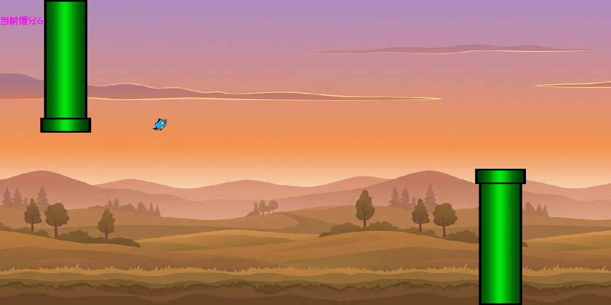
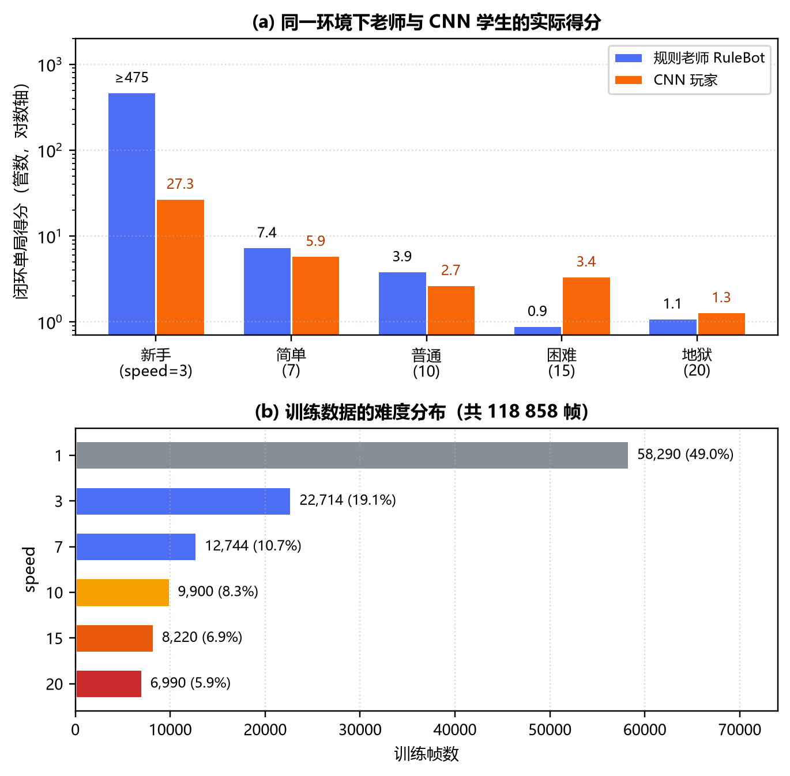

# Flappy Bird TinyCNN

> 一个可以从头读到尾的**微型 CNN 案例**：160×80 灰度图进，跳 / 不跳出。

[](https://www.python.org/)
[](https://pytorch.org/)
[](https://www.pygame.org/)
[](LICENSE)

**中文** | [English](README_EN.md)



---

## 这是什么

不是一个“调包跑起来”的 AI demo，而是一个**完整但足够小**的监督学习闭环：

规则老师打游戏 → 多进程录下 17 万帧「画面 + 动作」 → 一个 166 万参数的小 CNN 学会模仿 → 装回游戏里实时玩。

全部 Python 约 1100 行，没有强化学习框架、没有第三方训练库，`ai_model.py` 只有 34 行，一个下午就能读完；
跑起来不需要显卡，clone 下来直接能玩、也能重训。

**适合谁**：想第一次完整走通「图像输入 → 卷积 → 动作输出」的人；想找一个能改、能玩、讲得清楚的课程作业参考的人。

## 规模一览

| 维度 | 规模 |
|---|---|
| 输入 | 1×80×160 灰度图 + 2 个速度标量 |
| 网络 | 3 层卷积 + 3 层全连接，166 万参数（`ai_model.py` 34 行） |
| 代码 | 11 个脚本，约 1 100 行 Python |
| 数据 | 169 920 帧 / 6 档速度 / 16 MB |
| 训练 | 30 epoch，单卡几分钟；纯 CPU 也能跑完 |
| 推理 | CPU 1.3 ms/帧，稳定 60 FPS |
| 成绩 | 五档难度全部能长期存活；地狱单局 141 分 |

## 效果

自动评测（CPU 推理、每档 3 局、单局最多 4000 帧 ≈ 66 秒）：

| 难度 | speed | 三局得分 |
|:---:|:---:|:---:|
| 新手 | 3 | 30 / 30 / 30 |
| 简单 | 7 | 52 / 52 / 52 |
| 普通 | 10 | 62 / 62 / 62 |
| 困难 | 15 | 71 / 71 / 71 |
| 地狱 | 20 | 81 / 81 / 81 |

15 局全部打到截断点仍未撞管，所以表里的数字是"至少这么多"。

把上限放宽到 1 万帧（约 2.7 分钟）再跑地狱难度：两局分别拿到 **141 分** 和 63 分——也就是说它已经能连续穿过一百多根管子，但长局里偶尔还是会失误。手动开一局时跑到过接近 200 分。

> 反过来，地狱难度也偶尔会开局就撞、拿到 0 分，原因写在下面的[已知限制](#已知限制)里，不是数据造假。

## 快速开始

```bash
git clone https://github.com/yvhcel888/flappy-bird-tiny-cnn.git
cd flappy-bird-tiny-cnn
pip install -r requirements.txt
python main.py
```

启动后是 Tkinter 选单：选小鸟、选难度、勾上 **启用 AI 游玩**，点开始即可看它自己玩。

> 没有独显也能跑：模型在 CPU 上推理，显存为 0。仓库自带 `flappy_ai.pth`，不需要先训练。

### 重新采集数据（可选，约 13 分钟）

```bash
python 多进程录制.py
```

会用 6 个进程并行跑 6 个速度档，每个速度采 30 局、每局 12 分，产出 `data/train_data_speed*_bird*.npz`。

### 重新训练（可选）

```bash
python train_ai.py
```

30 个 epoch，把 `data/` 下所有 npz 读进显存一起训，结束后覆盖 `flappy_ai.pth`。
GPU 上几秒一个 epoch，纯 CPU 也能跑完，只是慢一些。

## 它是怎么学会的

```
┌──────────────┐   6 进程并发   ┌───────────────┐   train_ai.py   ┌───────────────┐
│ RuleBot 老师  │ ────────────> │ data/*.npz    │ ──────────────> │ flappy_ai.pth │
│ 纯几何规则    │  6 档 × 30 局  │ 169 920 帧    │   加权交叉熵     │   6.6 MB      │
└──────────────┘               └───────────────┘                 └───────┬───────┘
                                                                        │ ai_helper.py
                                                                        ▼
                                                              每帧推理 → 跳 / 不跳
```

### 老师：一条几何规则就够了

`ai_helper.RuleBot` 只做四件事，却能在地狱难度下一直玩下去：

1. **始终瞄准下一根管子的安全高度**（缝隙中心 + 半个跳跃高度），不管管子还有多远；
2. **低于安全高度就拍翅**，允许连续拍翅——爬升速度上限 450 px/s，比一次跳跃的 67 px 快得多；
3. **管子右沿还没离开鸟身就不换目标**，否则会在换管瞬间撞上刚才那根；
4. **前方暂时没管子时**（地狱档管间距 1350 已经超过屏幕宽度）先悬在 y=400 等它出现。

> 早期版本的老师是"离管子 200 px 以内才开始瞄准"，在地狱难度只有 0.125 秒的操作窗口，物理上根本来不及爬升——这正是旧版 AI 只在最低难度能得分的根因之一。

### 学生：166 万参数的小 CNN

| 部分 | 结构 |
|---|---|
| 图像分支 | `Conv(1→16, 3×3) → Pool → Conv(16→32) → Pool → Conv(32→64) → Pool → Flatten`，输出 64×10×20 = 12 800 维 |
| 速度分支 | `Linear(2→16)`，输入是 `vy/1000` 和 `管速/500` |
| 融合 | `Linear(12800+16 → 128) → ReLU → Linear(128 → 2)`，输出"跳 / 不跳"两类 |

- **输入**：160×80 灰度图（把 1200×600 的画面缩小 7.5 倍，只画管子和鸟）
- **标签**：老师在这一帧的动作，交叉熵 + 按类别频率加权（跳只占 7.95%）
- **训练**：Adam，lr=1e-3，batch 1024，30 epoch，数据全放显存

### 数据采集的两个小心思

- **不再只留满分局**：只要过了至少 1 分就保留。失败局里那些"已经偏离中心"的状态恰恰是模型实战会遇到的。
- **3% 概率"晚跳一拍"**：执行动作时偶尔故意漏跳一次，但训练标签仍然记老师的正确动作——相当于做了一次轻量 DAgger，让数据里出现"偏了怎么救回来"的样本。

## 项目结构

| 文件 | 作用 |
|---|---|
| `main.py` | 入口：读选单结果 → 按难度换算 speed → 进游戏 |
| `ui_ai.py` | Tkinter 选单（选鸟 / 难度 / 是否启用 AI） |
| `game.py` | 游戏主循环、渲染、AI 接入点、160×80 小图渲染 |
| `bird.py` / `pipe.py` | 小鸟与管道的物理、碰撞、绘制 |
| `ai_model.py` | `FlappyNet` 网络结构（34 行） |
| `ai_helper.py` | 特征提取、模型推理、数据记录、规则老师 `RuleBot` |
| `多进程录制.py` | 6 进程数据采集 |
| `train_ai.py` | 训练脚本 |
| `check_data.py` | 把 npz 里的帧导出成 png，方便肉眼检查数据 |
| `data/*.npz` | 训练集（169 920 帧，16 MB） |
| `flappy_ai.pth` | 训练好的权重（6.6 MB） |
| `docs/` | 截图、旧版本分析报告（PDF / DOCX） |
| `font/` | 开源字体站酷快乐体（ZCOOL KuaiLe，SIL OFL 1.1） |

## 旧版本复盘：为什么一开始只有新手能拿 20 分

仓库里 `docs/old-version-analysis.pdf` 是我对**第一版**做的完整分析：那一版在新手难度只能拿 20 多分，其他难度个位数。结论有三条，现在都已经修掉：

1. **老师自己不会玩**——旧版规则机器人把鸟压在 y≈420 巡航，离管子 200 px 才开始瞄准，地狱难度下窗口只有 0.125 秒、最多上升 45 px，而缝隙可能在上方 250 px 处。所谓"满分局"其实是连续抽到低缝隙的运气局，标签本身没有策略信息。
2. **只保留成功对局**——失败局整段删除，模型从来没见过"偏了以后怎么救"的状态，闭环里误差会复合放大。
3. **输入被压得太狠**——三次 2× 池化后一个格子对应 60×60 真实像素，而缝隙只有 180 px、鸟 24 px，量化误差和容错是同一个量级。

> 注意：那份报告描述的是**旧版本**的问题，其中的截图和数据都不代表当前代码。



## 已知限制

- **单帧输入**：看不到管子的运动方向，只能靠 `speed` 这个标量推断节奏；把 dt 抖动（掉帧）当成分布外输入。
- **空间分辨率粗**：三次池化让竖直方向的分辨率变成 60 px，地狱难度换管时偶尔会撞一下。
- **地狱难度偶尔会开局就撞，得 0 分**：这一档管间距 1350 px 已经超过屏幕宽度，下一根管子露头时只剩 0.55 秒；
  如果缝隙位置又很高（下方管道很长），留给鸟爬升的时间就更紧。实战中帧率不稳会让 dt 变大，
  偶尔会出现一根管子都没过就撞的情况。同一档它多数时候能连过几十上百根，所以这是难度和物理共同决定的边界，
  不是模型没学会。
- **上限是老师**：纯模仿学习，教师规则想不到的动作它也学不会；想更强得换强化学习。
- **只适配 1200×600 / 60 FPS**：物理按 dt=1/60 训练，机器太卡导致掉帧时表现会变差。

## 素材与致谢

| 素材 | 来源 |
|---|---|
| 背景图（昼 / 午 / 夜 × 晴 / 雨 / 雪，共 9 张） | Gemini 生成 |
| 小鸟精灵 | [OpenGameArt](https://opengameart.org/) 上的 bevouliin 素材包，原始名字是 `Blue Bird Sprite Sheets`、`Flappy Pink Bird`、`flying flappy bird game asset sprite sheets art`、`Free Green Flappy Stupid Bird sprite sheets`（原包都保留在 `img/bird/` 下，`Transparent/` 是按颜色重命名的版本） |
| 管道 | 同样来自 [OpenGameArt](https://opengameart.org/)（和小鸟是同一个素材站） |
| GameOver 图 | 作者自己画的 |
| 字体 | 仓库自带 **站酷快乐体**（`font/ZCOOLKuaiLe-Regular.ttf`，SIL OFL 1.1，可自由使用）；华文楷体 `STKAITI.TTF` 有版权，不随仓库分发 |

美术素材的授权请遵循原作者条款，MIT 许可证只覆盖代码。

## License

[MIT](LICENSE) © 2026 yvhcel888
