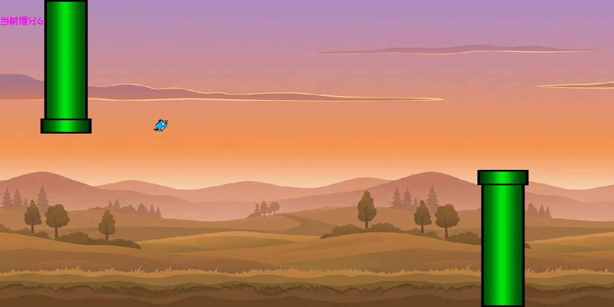

# Flappy Bird TinyCNN

> A tiny **1.66M-parameter CNN** that plays all five difficulty levels of Flappy Bird from a **160×80** grayscale thumbnail.

[](https://www.python.org/)
[](https://pytorch.org/)
[](https://www.pygame.org/)
[](LICENSE)

[中文](README.md) | **English**



---

## Highlights

| | |
|---|---|
| 🪶 **Tiny input** | 160×80 grayscale frame + 2 scalars per step; 1.66M parameters, 6.6 MB |
| ⚡ **Real-time on CPU** | 1.3 ms per frame — 60 FPS with no GPU at all |
| 🎯 **One net, five levels** | Same weights for all difficulties; the level is just a scalar input |
| 🏆 **141 points on Hell** | 141 in an automated run; nearly 200 in a manual session |
| 🔁 **Fully reproducible** | Capture → train → play, all in this repo; the teacher is pure geometry and needs no GPU |
| 📦 **Data + weights included** | 170k frames of training data and a trained checkpoint, ready to play or retrain |

## Results

Automated evaluation (CPU inference, 3 episodes per level, each capped at 4000 frames ≈ 66 s):

| Level | speed | three runs |
|:---:|:---:|:---:|
| Novice | 3 | 30 / 30 / 30 |
| Easy | 7 | 52 / 52 / 52 |
| Normal | 10 | 62 / 62 / 62 |
| Hard | 15 | 71 / 71 / 71 |
| Hell | 20 | 81 / 81 / 81 |

All 15 episodes were still alive when the cap hit, so these numbers are lower bounds.

With the cap raised to 10 000 frames (~2.7 min) on Hell difficulty, two runs scored **141** and 63 — it can clear well over a hundred pipes, but long runs still end in the occasional crash. A manual session reached close to 200.

## Quick start

```bash
git clone https://github.com/yvhcel888/flappy-bird-tiny-cnn.git
cd flappy-bird-tiny-cnn
pip install -r requirements.txt
python main.py
```

A Tkinter menu appears: pick a bird, a difficulty, tick **启用 AI 游玩** (enable AI) and start. The trained checkpoint ships with the repo, so no training is needed.

### Re-capture the dataset (optional, ~13 min)

```bash
python 多进程录制.py
```

Six processes run the six difficulty levels in parallel, 30 episodes × 12 points each, writing `data/train_data_speed*_bird*.npz`.

### Retrain (optional)

```bash
python train_ai.py
```

30 epochs over every npz in `data/`, then overwrites `flappy_ai.pth`. Seconds per epoch on a GPU; a few minutes on CPU.

## How it works

```
┌──────────────┐   6 processes   ┌───────────────┐   train_ai.py   ┌───────────────┐
│ RuleBot      │ ──────────────> │ data/*.npz    │ ──────────────> │ flappy_ai.pth │
│ geometry only│  6 speeds × 30  │ 169,920 frames│  weighted CE    │    6.6 MB     │
└──────────────┘                 └───────────────┘                 └───────┬───────┘
                                                                          │ ai_helper.py
                                                                          ▼
                                                                per-frame inference → flap / glide
```

### The teacher: four lines of geometry

`ai_helper.RuleBot` does exactly four things, and it can survive indefinitely on Hell difficulty:

1. **Always aim at the next pipe's safe height** (gap centre + half a hop), no matter how far away the pipe is;
2. **Flap whenever below that height**, allowing consecutive flaps — it climbs at up to 450 px/s, far faster than a single 67 px hop;
3. **Never switch targets while the current pipe still overlaps the bird**, otherwise it clips the pipe it just passed;
4. **Hold altitude when no pipe is ahead** (on Hell the pipe spacing of 1350 px is wider than the screen), then react when one appears.

> The first version only started aiming within 200 px of a pipe — a 0.125 s window on Hell, physically too short to climb into a high gap. That was the main reason the old AI only scored on the easiest level.

### The student: a 1.66M-parameter CNN

| Part | Structure |
|---|---|
| Vision | `Conv(1→16, 3×3) → Pool → Conv(16→32) → Pool → Conv(32→64) → Pool → Flatten`, 64×10×20 = 12,800 features |
| Speed | `Linear(2→16)` on `vy/1000` and `pipe_speed/500` |
| Fusion | `Linear(12800+16 → 128) → ReLU → Linear(128 → 2)`, "flap" vs "glide" |

- **Input**: a 160×80 grayscale view of the 1200×600 game (7.5× downscale, only pipes and the bird are drawn)
- **Labels**: the teacher's action for that frame; class-weighted cross-entropy (flaps are 7.95% of samples)
- **Training**: Adam, lr=1e-3, batch 1024, 30 epochs, whole dataset kept in VRAM when available

### Two tricks in the data collector

- **Keep failed episodes too** (any score ≥ 1). Off-centre states in failed runs are exactly what the policy will meet at play time.
- **Skip a flap 3% of the time** while still recording the teacher's correct label — a lightweight DAgger that puts "how to recover" states into the dataset.

## Repository layout

| File | Purpose |
|---|---|
| `main.py` | Entry point: menu result → speed → game loop |
| `ui_ai.py` | Tkinter menu (bird / difficulty / AI toggle) |
| `game.py` | Game loop, rendering, AI hook, 160×80 mini-frame renderer |
| `bird.py` / `pipe.py` | Bird and pipe physics, collision, drawing |
| `ai_model.py` | `FlappyNet` definition (34 lines) |
| `ai_helper.py` | Feature extraction, inference, recording, `RuleBot` teacher |
| `多进程录制.py` | Multi-process data capture |
| `train_ai.py` | Training script |
| `check_data.py` | Dump recorded frames as PNGs for eyeballing |
| `data/*.npz` | Training set (169,920 frames, 16 MB) |
| `flappy_ai.pth` | Trained weights (6.6 MB) |
| `docs/` | Screenshot and the old-version analysis report (PDF / DOCX) |

## Post-mortem: why the first version only scored ~20 on Novice

`docs/old-version-analysis.pdf` analyses **the first version**, which scored ~20 on Novice and single digits everywhere else. Three root causes, all since fixed:

1. **The teacher itself could not play** — it cruised at y≈420 and only started aiming within 200 px of a pipe. On Hell that is a 0.125 s window and at most 45 px of climb, while the gap can sit 250 px above. Its "perfect" episodes were lucky low-gap runs, so the labels carried almost no strategy.
2. **Only successful episodes were kept** — failed runs were deleted, so the model never saw a state that needed recovery, and errors compounded in closed loop.
3. **The input was compressed too hard** — three 2× pools leave 60×60 real pixels per feature cell, while the gap is 180 px and the bird 24 px; quantisation error is the same order as the margin.

> That report describes the **old** version; its screenshots and numbers do not reflect the current code.


## Known limitations

- **Single frame**: the network cannot see which way a pipe is moving, only a `speed` scalar; frame-rate jitter (dt changes) is out of distribution.
- **Coarse spatial resolution**: three pools leave 60 px vertical resolution, so Hell occasionally clips a pipe during a transition.
- **Teacher-bounded**: pure imitation learning cannot exceed the rule it imitates; going further needs RL.
- **Tuned for 1200×600 @ 60 FPS**: physics were recorded at dt = 1/60, so heavy frame drops hurt.

## Credits

| Asset | Source |
|---|---|
| Backgrounds (day / noon / night × sunny / rain / snow) | Generated with Gemini |
| Bird sprites | [OpenGameArt](https://opengameart.org/), packs by bevouliin: `Blue Bird Sprite Sheets`, `Flappy Pink Bird`, `flying flappy bird game asset sprite sheets art`, `Free Green Flappy Stupid Bird sprite sheets` (all kept under `img/bird/`; `Transparent/` is a recoloured copy) |
| Pipes | Also from [OpenGameArt](https://opengameart.org/), the same site as the birds |
| Game-over art | Bundled with the project |
| Font | `font/STKAITI.TTF` is a commercial Chinese font and is **not** distributed here; the game falls back to a system font when it is missing |

Please follow the original authors' terms for the art assets. The MIT licence covers code only.

## License

[MIT](LICENSE) © 2026 yvhcel888
